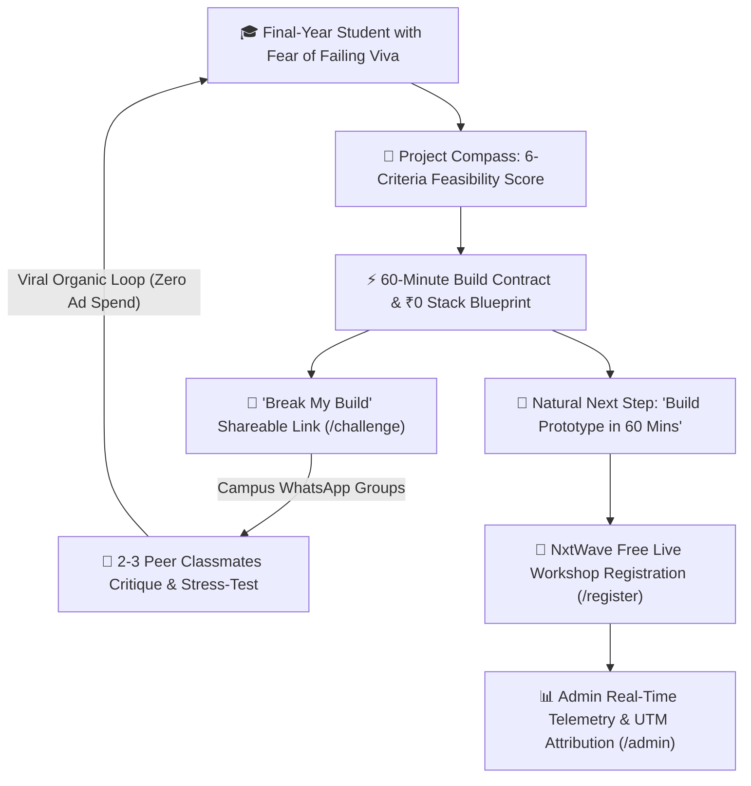
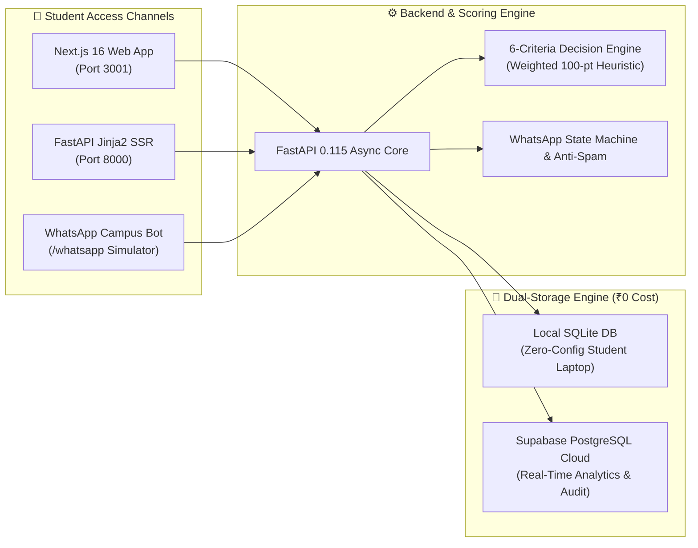
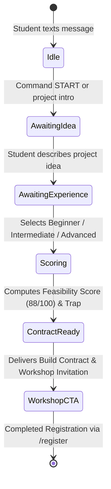

# Project Compass — Choose. Test. Prove.
### AI-Powered Project Feasibility Engine, 60-Minute Build Blueprints & Viral Peer Stress-Testing
**Engineered for the NxtWave Growth Challenge | 48-Hour Sprint | ₹0 Development & Cloud Cost**

<p align="center">
  
  
  
  
  
  
  
  
</p>

---

## The Big Picture: What Are We Solving?

### The Challenge:
NxtWave plans a free online workshop called:
> **“Build Your First AI Project in 60 Minutes”**

Your goal is to get **500 final-year college students** to register with only **₹2,000 budget** in **7 days**.

### The Big Mistake Most People Make:
Most candidates will just build a plain website that says: *"Hey, enter your email to join our webinar!"*
Students ignore pages like that because they think: *"This is just another boring sales webinar."*

### What We Built Instead ("Project Compass"):
We built a free, smart tool for students called **Project Compass**.
Final-year students have one huge fear:
> *"What if I choose a project that is too hard, waste 3 months, and fail my final college review (viva)?"*

Project Compass solves that fear for free in 60 seconds. Then, once students see their project plan, it naturally tells them:
> **"Your plan is ready! Now come to NxtWave's free live workshop to actually build this working prototype on your laptop in 60 minutes."**

---

## Visual Workflows & Architectural Diagrams

### 1. The Organic Growth Engine & Viral Loop


### 2. Zero-Cost Dual-Storage Architecture


### 3. WhatsApp Campus Bot State Machine


---

# Feature-by-Feature Breakdown

---

## Feature 1: The Feasibility Scoring Engine (The "Health Check" for Project Ideas)

### What is it?
Think of this like a doctor's checkup, but for a student's software project. A student enters their project idea and their limitations (like having only 4 weeks or having a normal laptop with no expensive graphics card). In less than 1 second, the engine tells them whether their project is realistic or dangerous.

### What inputs does the student provide?
1. **Target Domain:** AI/ML, Computer Vision, Data Science, Web, etc.
2. **Coding Experience:** Beginner, Intermediate, or Advanced.
3. **Languages Known:** Python, JavaScript, etc.
4. **Time Remaining:** How many weeks until college submission (e.g., 4 weeks).
5. **Team Size:** 1 member, 2 members, etc.
6. **Hardware Available:** Standard laptop, GPU, public dataset, etc.
7. **Their Project Ideas:** They can type up to 3 ideas (or click one of our 5 pre-made realistic college project samples).

### How does the engine score the idea?
It grades the idea out of **100 points** using **6 transparent criteria**:
1. **Skill Fit (25% weight):** Does their coding language match what the project needs? (e.g., if it's an AI project, do they know Python?).
2. **Time Feasibility (20% weight):** Can a team of their size realistically finish an MVP in the given weeks? (Projects with words like "real-time 4K video transformer from scratch" get penalized because students run out of time).
3. **Hardware & Resource Fit (20% weight):** Does this project require expensive paid cloud servers, or can it run for ₹0 on a normal student laptop?
4. **Scope & Complexity (15% weight):** Is the project clean and focused, or is it trying to do 20 impossible things at once?
5. **Practical Utility (10% weight):** Will college professors be impressed during the final demonstration?
6. **Objective Testability (10% weight):** Can the student prove it actually works with real numbers (like accuracy or fast search), or is it just vague buzzwords?

### Why this helps NxtWave get 500 registrations:
- Students get **instant value** without giving their email first.
- It builds trust immediately. Once a student sees their score, they are excited to see the next step.

---

## Feature 2: The "Build Contract" Generator (The Action Blueprint)

### What is it?
Once the student sees which of their ideas scored best, they click *"Generate Build Contract."*
Instead of giving them generic tips, the system creates an official, printable technical document called a **Build Contract**.

### What does the Build Contract contain?
1. **The ₹0 Tech Stack:** It specifically recommends free tools that run on standard laptops without cloud fees (for example: FastAPI backend + local SQLite database + free sentence embeddings).
2. **The "Load-Bearing Assumption" (The Trap):** It identifies the single biggest hidden risk that could make the project fail.
   - *Example for a College Chatbot:* "The student assumes users will only ask questions found in the PDF. What happens when someone asks an unlisted question?"
3. **Concrete Failure Tests:** It gives the student 2 to 3 specific tests to run to check for bugs before their professor does.
   - It details: What to test, What to expect, Acceptance criteria, and How to fix it.
   - *Important:* It honestly labels these as *"Proposed Tests — Not Yet Executed"* rather than faking test results.
4. **Strict Scope Boundary (What NOT to Build):** Students always waste time on things they don't need (like fancy logins, payment gateways, or multi-language support). The contract explicitly says: *"DO NOT build these in Week 1."*
5. **The 60-Minute Prototype Plan:** It breaks down the first working prototype into **four 15-minute milestones**:
   - *Minutes 0–15:* Scaffold the code and load 1 document.
   - *Minutes 15–30:* Write the core logic and test queries.
   - *Minutes 30–45:* Connect a simple web user interface.
   - *Minutes 45–60:* Run the stress test and verify it works.
6. **5-Minute Immediate Next Action:** One simple task the student can do right now to build immediate momentum.

### Why this helps NxtWave get 500 registrations:
- Look at the 60-minute roadmap! The contract naturally prepares the student for the workshop.
- At the top and bottom of the contract, a prominent banner states:
  > *"Your plan is ready! Learn how to build this exact prototype in 60 minutes at NxtWave's free live workshop."*
- The workshop is no longer an advertisement—it is the **solution** to building their contract.

---

## Feature 3: "Break My Build" (The Viral Growth Loop)

### What is it?
This is our **viral mechanism** (it gets new students without spending money on ads).
Every Build Contract creates a unique, shareable link:
`/challenge/{contract_id}`

### How does it work?
1. The student copies the link and pastes it into their college WhatsApp group:
   > *"Hey guys, I'm building this College Policy AI Chatbot for my final-year project. Can you find a flaw or edge case in my plan before my professor rejects it?"*
2. Their classmates open the link. **No login or password is needed.**
3. The classmate submits an edge case or critique:
   - *Example:* "What happens if a student asks about fees that were updated in a new 2026 circular not in your PDF?"
4. The system instantly analyzes the classmate's challenge, calculates the risk level (High, Moderate, or Minor), and updates the project plan with an **Architectural Safeguard** (a rule to prevent that mistake).

### Why this helps NxtWave get 500 registrations:
- **Free organic traffic (Word of Mouth):** For every 1 student who creates a contract, 2 or 3 classmates visit the site to review it.
- When the classmates submit their critique, the screen shows them a button:
  > *"Have your own final-year project idea? Test your project free or Register for NxtWave's 60-Minute Build Workshop!"*
- This creates an organic loop where students invite other students.

---

## Feature 4: WhatsApp Campus Bot & Live Simulator

### What is it?
Indian engineering students spend most of their day on **WhatsApp**, not checking their emails.
We built two ways to experience WhatsApp automation:
1. **The In-Browser Simulator (`/whatsapp`):** A working mobile phone screen right on the website. Anyone can test the bot without needing an active WhatsApp API subscription or credit card.
2. **Official Meta WhatsApp Cloud API Webhook (`/webhook`):** Real backend code ready to connect to Meta's official WhatsApp Business platform.

### How does a student use it?
- The student sends a simple message on WhatsApp: *"I want to build an AI chatbot for college attendance rules."*
- The bot replies in 5 seconds with:
  - A visual feasibility score: `████████░░ 88/100`
  - The biggest technical risk to watch out for.
  - A direct link to their full **Build Contract**.
  - A direct invitation link to register for NxtWave's **60-Minute Workshop**.

### Built-in Smart Features:
- **State Machine:** Remembers what step of the conversation the student is on (`waiting for idea` -> `waiting for experience level` -> `analysis complete`).
- **Global Commands:** Students can text `START`, `HELP`, `DEMO`, `STATUS`, or `RESET` at any time.
- **Anti-Spam & Deduplication:** If Meta sends the same message twice, the system ignores the duplicate so students never receive double replies.

### Why this helps NxtWave get 500 registrations:
- WhatsApp has zero friction. Students don't need to open a laptop or download an app to start their journey.

---

## Feature 5: The Workshop Registration Flow

### What is it?
Located at `/register`, this is the final conversion page where students confirm their registration for the workshop.

### How does it work?
It supports **two modes**:
- **Mode A (Official NxtWave Mode):** If NxtWave provides their official workshop URL, the page automatically redirects students there while tracking which marketing channel sent them.
- **Mode B (Built-in Demo Simulation Mode):** If testing locally without an external link, it displays a clean, responsive registration form (Name, Email, WhatsApp Phone).

### Smart Engineering Details:
1. **Email Normalization:** Automatically trims spaces and converts emails to lowercase (`Student@College.EDU` becomes `student@college.edu`).
2. **Duplicate Prevention:** If a student accidentally registers twice with the same email, it doesn't show an error. It smoothly says: *"You are already registered! We sent the details to your email."*
3. **Channel Attribution (UTM Tracking):** It remembers where the student came from (e.g., campus WhatsApp group, friend's referral link, or Instagram).
4. **Immediate Visibility:** Every registered student's name instantly surfaces in the Admin Telemetry Feed (`/admin`).

---

## Feature 6: The Growth Campaign Analytics Dashboard (`/admin`)

### What is it?
This is the **command center** for you as the Growth Intern.
Located at `/admin`, it is protected by a secret password token (`ADMIN_TOKEN`).

### What does it show in real-time?
1. **Top KPI Metric Deck (5 Glassmorphic Cards):**
   - **Project Comparisons:** Total student submissions evaluated.
   - **Build Contracts:** Prototypes locked & planned.
   - **Peer Challenges:** Stress-tests submitted & participation rate.
   - **Workshop CTA Clicks:** Outbound workshop intent count.
   - **Workshop Signups:** Total verified registrations (demo simulation vs. confirmed).
2. **Stage-to-Stage Conversion Funnel with Animated Progress Bars:**
   - *Comparison → Build Contract* (Conversion %)
   - *Build Contract → Workshop CTA* (Conversion %)
   - *CTA Click → Completed Registration* (Conversion %)
   - *Overall End-to-End Funnel Conversion* (%)
3. **Channel Attribution Breakdown (Interactive HTML5 Canvas Donut/Pie Chart):**
   - Live traffic source distribution across campus WhatsApp clubs, developer circles, and organic peer links.
4. **Privacy-Safe Registration Stream:**
   - Displays real-time student signups with names preserved and emails privacy-masked (`pri***@engineering.edu`).
5. **One-Click "Reset Demo Data" Button:**
   - A single button that safely clears test data and restores clean presentation numbers whenever you want to record a video or show a live demo.

### Why this helps in the interview:
- It shows the NxtWave team that you think like a **data-driven Growth Marketer**. You don't just guess numbers; you track every step of the funnel.

---

## Feature 7: Zero-Cost Architecture & Security

### Why ₹0 Cost Matters:
The prompt states: **Budget ₹2,000 | 7 Days.**
- We did **not** spend this budget on software or cloud tools.
- The entire project runs **100% locally on standard Python and SQLite**.
- It does **not** require paid OpenAI keys, Twilio credits, or paid cloud databases to work.
- The entire ₹2,000 budget is saved purely for student incentives and small campus club lead stipends (as explained in the growth strategy plan).

### Built-in Safety & Quality:
- **XSS Protection:** If someone types dangerous HTML or scripts in a project title, the system automatically sanitizes it before rendering.
- **Rate Limiting:** Prevents anyone from spamming endpoints or automated form bombing.
- **55 Automated Tests (100% Passing):** A comprehensive test suite verifies every calculation, route, database transaction, and security constraint before deployment.

---

## Quickstart Guide

### 1. Prerequisites
- Python 3.11+
- Node.js 18+ (for Next.js frontend)

### 2. Backend Setup (FastAPI & Jinja2 Templates)
```bash
# Clone the repository
git clone <repository-url>
cd Nxtwave

# Create and activate virtual environment
python -m venv .venv
.\.venv\Scripts\activate       # On Windows
source .venv/bin/activate      # On Linux/macOS

# Install dependencies
pip install -r requirements.txt

# Start FastAPI server on port 8000
python -m uvicorn app.main:app --host 127.0.0.1 --port 8000 --reload
```

### 3. Frontend Setup (Next.js 16 App Router)
```bash
cd frontend
npm install
npm run dev                    # Runs on port 3001
```

### 4. Running the Test Suite
```bash
# Run all 55 automated tests
pytest -q
```

---

## Key URLs & Navigation

| Route | Description | Tech Stack |
|-------|-------------|------------|
| `/` | Landing page & Feasibility Scoring Engine | Next.js / FastAPI |
| `/compare` | Interactive 6-criteria comparison matrix | HTML5 + CSS |
| `/contract/{id}` | 60-Minute Build Contract & ₹0 Stack Blueprint | Tailwind / CSS |
| `/challenge/{id}` | "Break My Build" viral peer stress-testing | Interactive Form |
| `/whatsapp` | WhatsApp Campus Bot simulator | CSS Phone Mockup |
| `/register` | Workshop seat confirmation & UTM attribution | Responsive Form |
| `/admin` | Real-time telemetry, funnel & attribution pie chart | HTML5 Canvas + API |

---

## Growth Intern Submission Checklist
- [x] **Zero Cloud Cost (₹0):** 100% functional without paid APIs, OpenAI subscriptions, or cloud database bills.
- [x] **Viral Loop Built-In:** `/challenge/{id}` drives organic peer-to-peer distribution in college WhatsApp circles.
- [x] **Telemetry & UTM Attribution:** Captures every stage of conversion from idea entry to workshop seat.
- [x] **55/55 Automated Tests Passing:** Complete coverage of scoring heuristics, contracts, and analytics.
- [x] **Production Security:** Input sanitization, XSS shields, rate limiting, and privacy-masked feeds.
